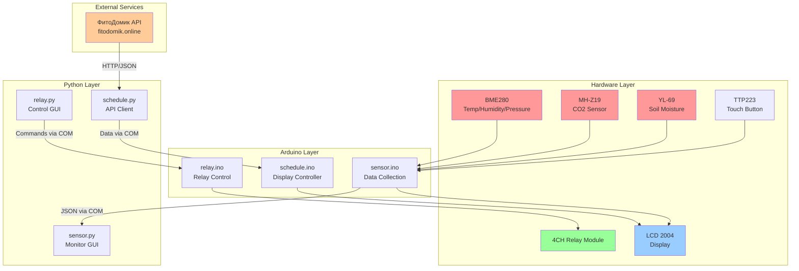

# 🌱 Мини-ферма на Arduino

## 📋 Оглавление
- [Что это такое?](#-что-это-такое)
- [Используемые компоненты](#-используемые-компоненты)
- [Как это работает](#-как-это-работает)
- [Алгоритм работы](#-алгоритм-работы)
- [Команды управления](#-команды-управления)
- [Настройки по умолчанию](#%EF%B8%8F-настройки-по-умолчанию)
- [Технические детали](#-технические-детали)
- [Последовательность запуска](#-последовательность-запуска)

## 🤔 Что это такое?

Это автоматическая система для выращивания растений! Программа управляет мини-фермой (или гидропонной системой) и автоматически поддерживает идеальные условия для роста растений:
- 🌡️ Следит за температурой
- 💧 Контролирует полив
- 🌬️ Управляет вентиляцией
- ☀️ Регулирует освещение
- 🌫️ Измеряет уровень CO2

## 🔌 Используемые компоненты

### Датчики
| Датчик | Что измеряет | Как подключен |
|--------|--------------|--------------|
| 🌡️ **BME280** | Температура, влажность, давление | I²C |
| 💧 **YL-69** | Влажность почвы | Аналоговый вход A0 |
| 🌫️ **MH-Z19** | Уровень CO2 | Пины 3-4 (SoftwareSerial) |
| 🕒 **DS3231** | Время | I²C |

### Исполнительные устройства (4-канальное реле)
| Устройство | Назначение | Пин Arduino |
|------------|------------|-------------|
| 💡 **Лампа** | Освещение растений | D5 (канал 1) |
| 🪟 **Шторы** | Затемнение/освещение | D6 (канал 2) |
| 💦 **Насос** | Полив растений | D7 (канал 3) |
| 🌀 **Вентилятор** | Охлаждение и циркуляция воздуха | D8 (канал 4) |

### Дисплей
📟 **LCD2004 I²C** - показывает информацию о состоянии системы (20×4 символов)

## 🔄 Как это работает

### Автоматическое управление
- 💦 **Насос** включается, когда почва слишком сухая
- 🌀 **Вентилятор** включается, когда слишком жарко
- 🪟 **Шторы** открываются утром и закрываются вечером
- 💡 **Лампа** включается и выключается по расписанию

### Что показывает дисплей
Экран автоматически переключается каждые 5 секунд и показывает:

1. 🕒 **Время и дата** - текущее время с DS3231
2. 💧 **Влажность почвы** - текущее и целевое значение
3. 🌡️ **Климат** - температура, влажность воздуха, давление
4. 🌫️ **CO2** - уровень углекислого газа и целевое значение
5. ⚙️ **Устройства** - состояние всех подключенных устройств

## 🔍 Алгоритм работы

### Контроль влажности почвы
```
ЕСЛИ влажность_почвы < (целевое_значение - допуск) ТОГДА
    включить насос
ИНАЧЕ ЕСЛИ влажность_почвы >= целевое_значение ТОГДА
    выключить насос
```

### Контроль температуры
```
ЕСЛИ температура > (целевое_значение + допуск) ТОГДА
    включить вентилятор
ИНАЧЕ ЕСЛИ температура <= целевое_значение ТОГДА
    выключить вентилятор
```

### Управление по времени
```
ЕСЛИ текущее_время >= время_открытия_штор И текущее_время < время_закрытия_штор ТОГДА
    открыть шторы
ИНАЧЕ
    закрыть шторы

ЕСЛИ текущее_время >= время_включения_лампы И текущее_время < время_выключения_лампы ТОГДА
    включить лампу
ИНАЧЕ
    выключить лампу
```

## 📡 Команды управления

### Команды от компьютера к Arduino
| Команда | Пример | Что делает |
|---------|--------|------------|
| **TIME:** | `TIME:2023-05-20-14-30-00` | Устанавливает дату и время |
| **SET:TEMP:** | `SET:TEMP:25` | Устанавливает целевую температуру |
| **SET:SOIL:** | `SET:SOIL:50` | Устанавливает целевую влажность почвы |
| **SET:CO2:** | `SET:CO2:800` | Устанавливает целевой уровень CO2 |
| **LED:** | `LED:1` или `LED:0` | Включает/выключает лампу |
| **CURTAINS:** | `CURTAINS:1` или `CURTAINS:0` | Открывает/закрывает шторы |
| **RELAY3:** | `RELAY3:1` или `RELAY3:0` | Включает/выключает насос |
| **RELAY4:** | `RELAY4:1` или `RELAY4:0` | Включает/выключает вентилятор |
| **GET_SENSORS** | `GET_SENSORS` | Запрашивает данные с датчиков |
| **GET_DEVICES** | `GET_DEVICES` | Запрашивает состояние устройств |

### Ответы от Arduino к компьютеру
| Формат | Пример | Что означает |
|--------|--------|-------------|
| **SENSORS:** | `SENSORS:24.5:65.2:40:500:750:1013.2` | Температура:влажность:влажность_почвы:освещенность:co2:давление |
| **DEVICES:** | `DEVICES:1:0:1:0` | Состояние лампы:штор:насоса:вентилятора (1=вкл, 0=выкл) |

## ⚙️ Настройки по умолчанию

| Параметр | Значение | Допуск |
|----------|----------|--------|
| 🌡️ **Температура** | 25°C | ±3°C |
| 💧 **Влажность почвы** | 50% | ±5% |
| 🌫️ **CO2** | 800 ppm | ±200 ppm |
| 🪟 **Шторы** | Открываются в 8:00, закрываются в 20:00 | - |
| 💡 **Лампа** | Включается в 8:30, выключается в 21:00 | - |

## 🔧 Технические детали

- 📊 **Датчик почвы** калибруется значениями: сухая почва = 1000, мокрая = 200
- 🔌 **Реле** активируются сигналом LOW (активный низкий уровень)
- 🔄 **CO2 датчик** опрашивается каждые 5 секунд
- 📟 **Дисплей** обновляется каждые 5 секунд
- 🕒 **Время** обновляется каждую секунду (если установлено)

## 🔌 Последовательность запуска

### 1. Инициализация
- ✅ Запуск Serial порта (9600 бод)
- ✅ Инициализация I²C шины
- ✅ Включение LCD дисплея и приветствие
- ✅ Поиск датчика BME280
- ✅ Настройка SoftwareSerial для CO2 датчика
- ✅ Настройка пинов реле и их выключение
- ✅ Отправка "READY" в Serial порт

### 2. Основной цикл
- 📡 Проверка команд в Serial порту
- 🕒 Обновление времени на дисплее
- 🌫️ Чтение уровня CO2
- ⚙️ Управление устройствами по алгоритму
- 📟 Переключение экрана каждые 5 секунд

### 3. Работа с датчиками
- 🌡️ **BME280**: чтение при отображении и управлении
- 💧 **YL-69**: чтение при отображении и управлении насосом
- 🌫️ **MH-Z19**: чтение каждые 5 секунд
- 🕒 **DS3231**: чтение каждую секунду для управления по времени

### 4. Управление устройствами
Система постоянно проверяет условия и автоматически управляет всеми устройствами для поддержания идеальных условий для растений.

---

📝 **Примечание:** Система работает полностью автоматически, но все параметры можно изменить через Serial порт с помощью приложения fitodomik.py.

## Подключение Arduino Nano и формат расписания

Документация ниже относится к модулям из `MODULE/`. Сверяйте распиновку с выбранным скетчем.

<details>
<summary>Схема подключения Arduino Nano</summary>

### Компоненты
- Arduino Nano (ATMega328)
- BME280 - датчик температуры, влажности и давления
- MH-Z19 - датчик CO2 (углекислого газа)
- YL-69 (FC-28) - датчик влажности почвы
- DS3231 - часы реального времени
- LCD 2004 I2C - дисплей 20x4 символа
- TTP223 - сенсорная кнопка
- Tinker Board - для сбора данных и построения графиков
#### BME280 (I2C)
- SDA → A4
- SCL → A5
#### DS3231 (I2C)
- SDA → A4
- SCL → A5
#### LCD2004 (I2C)
- SDA → A4
- SCL → A5
#### YL-69 (FC-28)
- Аналоговый выход → A0
#### MH-Z19 (UART)
- TX → D3 (SoftwareSerial)
- RX → D2 (SoftwareSerial)
#### TTP223 (сенсорная кнопка)
- OUT → D4
#### 4CH Relay Module
- VCC → 5V на Arduino
- GND → GND на Arduino
- IN1 → D12 на Arduino - вентилятор
- IN2 → D11 на Arduino - насос
- IN3 → D10 на Arduino - шторы
- IN4 → D9 на Arduino - лампа

</details>

<details>
<summary>Строка состояния и расписания</summary>

Программа для получения данных с умной фермы ФитоДомик.
### Формат вывода данных
Программа выводит все данные в одну строку в формате:
`пороговые_значения|состояние_устройств|расписание`
#### Пороговые значения
Формат: `мин-макс;мин-макс;мин-макс;мин-макс`
Значения выводятся в следующем порядке:
1. Температура (°C)
2. Влажность воздуха (%)
3. Влажность почвы (%)
4. CO2 (ppm)
Пример: `20-30;40-60;50-70;800-1200`
#### Состояние устройств
Формат: `лампа,шторы`
Пример: `1,0`
Где:
- Лампа: 1 - включена, 0 - выключена
- Шторы: 1 - открыты, 0 - закрыты
#### Расписание
Формат: `интервалы_лампы;интервалы_штор`
Примеры:
- `0-5,10-12;6-8,13-14` - лампа включена с 0 до 5 часов и с 10 до 12 часов, шторы открыты с 6 до 8 часов и с 13 до 14 часов
- `0;0` - лампа и шторы выключены весь день
- `0-23;0` - лампа включена весь день, шторы закрыты весь день
#### Полный пример вывода
`20-30;40-60;50-70;800-1200|1,0|0-5,10-12;6-8,13-14`

</details>

<details>
<summary>Модули датчиков, реле и расписания</summary>

Система мониторинга и управления умной фермой на базе Arduino с интеграцией веб-API ФитоДомик.

### 1. Структура проекта

```
Arduino-Smart-Farm-System/
├── sensor/                    # Модуль сбора данных с датчиков
│   ├── sensor.ino            # Arduino код для сбора данных с датчиков
│   └── sensor.py             # Python GUI для мониторинга и визуализации
├── relay/                     # Модуль управления реле
│   ├── relay.ino             # Arduino код для управления 4-канальным реле
│   └── relay.py              # Python GUI для управления реле
├── schedule/                  # Модуль работы с расписанием
│   ├── schedule.ino          # Arduino код для отображения расписания на LCD
│   ├── schedule.py           # Python скрипт для получения данных с API
│   └── README.MD             # Документация по форматам данных
└── README.md                 # Основная документация проекта
```

### 2. Описание файлов

#### 2.1 Модуль sensor/

##### `sensor.ino` (Arduino)
**Назначение:** Основной скетч для сбора данных с датчиков и управления LCD дисплеем.

**Ключевые компоненты:**
- `SensorData` - структура для хранения данных датчиков
- `readSensors()` - чтение данных с BME280, MH-Z19, YL-69
- `displayScreen()` - циклическое отображение данных на LCD
- `handleSerialCommands()` - обработка команд по Serial

**Датчики:**
- BME280: температура, влажность, давление
- MH-Z19: уровень CO2
- YL-69: влажность почвы
- DS3231: часы реального времени

**Связи:** Отправляет JSON данные в `sensor.py` через COM-порт.

##### `sensor.py` (Python GUI)
**Назначение:** Графический интерфейс для мониторинга данных с датчиков в реальном времени.

**Ключевые классы:**
- `SensorMonitorApp` - основной класс GUI приложения
- `setup_plots()` - настройка графиков matplotlib
- `update_plots()` - обновление графиков в реальном времени
- `serial_worker()` - поток для чтения данных с Arduino

**Функциональность:**
- Визуализация данных в реальном времени
- Сохранение данных в файлы
- Темная тема интерфейса
- Масштабирование и навигация по графикам

**Связи:** Получает данные от `sensor.ino` через COM-порт.

#### 2.2 Модуль relay/

##### `relay.ino` (Arduino)
**Назначение:** Упрощенный контроллер для управления 4-канальным модулем реле.

**Ключевые функции:**
- `processCommand()` - обработка команд управления
- `setRelay()` - включение/выключение отдельного реле
- `toggleRelay()` - переключение состояния реле
- `setAllRelays()` - управление всеми реле одновременно

**Команды:**
- `1-4` - переключение реле 1-4
- `A+` - включить все реле
- `A-` - выключить все реле
- `S` - запрос статуса

**Связи:** Управляется через `relay.py` по COM-порту.

##### `relay.py` (Python GUI)
**Назначение:** Графический интерфейс для управления реле с визуальными индикаторами.

**Ключевые классы:**
- `RelayControlApp` - основной класс GUI
- `setup_ui()` - создание интерфейса с кнопками и индикаторами
- `serial_worker()` - поток для обмена данными с Arduino
- `process_response()` - обработка ответов от Arduino

**Функциональность:**
- Визуальные индикаторы состояния реле
- Кнопки управления отдельными реле
- Групповое управление (все вкл/выкл)
- Лог команд и ответов

**Связи:** Управляет `relay.ino` через COM-порт.

#### 2.3 Модуль schedule/

##### `schedule.ino` (Arduino)
**Назначение:** Отображение расписания и статуса устройств на LCD дисплее.

**Ключевые функции:**
- `parseAndDisplay()` - разбор данных и отображение на LCD
- `serialEvent()` - обработка входящих данных

**Формат данных:** `пороги|устройства|расписание`

**Связи:** Получает данные от `schedule.py` через COM-порт.

##### `schedule.py` (Python)
**Назначение:** Получение данных с API ФитоДомик и отправка на Arduino.

**Ключевые функции:**
- `get_fitodomik_data()` - получение данных с API
- `group_hours()` - группировка часов в интервалы
- `send_to_arduino()` - отправка данных на Arduino

**API эндпоинты:**
- `get-thresholds.php` - пороговые значения
- `get-sensor-data.php` - данные датчиков
- `get-schedule.php` - расписание устройств

**Связи:** Передает данные в `schedule.ino` через COM-порт.

### 3. Архитектура проекта

#### 3.1 Общая структура

Система состоит из трех независимых модулей, каждый из которых выполняет свою задачу:

1. **Sensor Module** - сбор и мониторинг данных
2. **Relay Module** - управление исполнительными устройствами
3. **Schedule Module** - интеграция с веб-API и отображение расписания

#### 3.2 Потоки данных



### 4. Библиотеки и зависимости

#### 4.1 Arduino Libraries

| Библиотека | Назначение | Используется в |
|------------|------------|----------------|
| `Wire.h` | I2C коммуникация | sensor.ino, schedule.ino |
| `LiquidCrystal_I2C.h` | Управление LCD дисплеем | sensor.ino, schedule.ino |
| `Adafruit_BME280.h` | Работа с датчиком BME280 | sensor.ino |
| `MHZ19_uart.h` | Работа с датчиком CO2 MH-Z19 | sensor.ino |
| `GyverButton.h` | Обработка нажатий кнопки | sensor.ino |

#### 4.2 Python Dependencies

| Библиотека | Назначение | Используется в |
|------------|------------|----------------|
| `tkinter` | GUI интерфейс | sensor.py, relay.py |
| `matplotlib` | Построение графиков | sensor.py |
| `serial` | COM-порт коммуникация | sensor.py, relay.py, schedule.py |
| `requests` | HTTP запросы к API | schedule.py |
| `threading` | Многопоточность | sensor.py, relay.py |
| `argparse` | Аргументы командной строки | sensor.py, relay.py |
| `numpy` | Численные операции | sensor.py |

### 5. Точки входа и запуск

#### 5.1 Arduino скетчи

**Загрузка на Arduino:**
1. Откройте Arduino IDE
2. Загрузите соответствующий .ino файл
3. Выберите плату Arduino Nano
4. Выберите правильный COM-порт
5. Нажмите "Загрузить"

**Порядок запуска:**
- `sensor.ino` - основной модуль (запускается первым)
- `relay.ino` - модуль управления (независимый)
- `schedule.ino` - модуль дисплея (независимый)

#### 5.2 Python приложения

**Установка зависимостей:**
```bash
pip install matplotlib pyserial requests numpy
```

**Запуск приложений:**

```bash
# Мониторинг датчиков
cd sensor/
python sensor.py -p COM4 -b 9600

# Управление реле
cd relay/
python relay.py -p COM4 -b 9600

# Получение данных расписания
cd schedule/
python schedule.py [API_TOKEN]
```

**Аргументы командной строки:**
- `-p, --port` - COM-порт (по умолчанию COM4)
- `-b, --baud` - Скорость передачи (по умолчанию 9600)
- `-l, --list` - Показать доступные порты

### 6. Схема подключения оборудования

#### 6.1 Arduino Nano подключения

| Компонент | Тип подключения | Пины Arduino |
|-----------|----------------|--------------|
| BME280 | I2C | SDA → A4, SCL → A5 |
| DS3231 | I2C | SDA → A4, SCL → A5 |
| LCD2004 | I2C | SDA → A4, SCL → A5 |
| YL-69 | Аналоговый | Аналоговый выход → A0 |
| MH-Z19 | UART | TX → D3, RX → D2 |
| TTP223 | Цифровой | OUT → D4 |
| 4CH Relay | Цифровой | IN1→D12, IN2→D11, IN3→D10, IN4→D9 |

#### 6.2 Назначение реле

| Реле | Пин | Назначение |
|------|-----|------------|
| Relay 1 | D12 | Вентилятор |
| Relay 2 | D11 | Насос |
| Relay 3 | D10 | Шторы |
| Relay 4 | D9 | Лампа |

### 7. Архитектурные особенности

#### 7.1 Модульная архитектура

**Преимущества:**
- Независимость модулей - каждый может работать автономно
- Легкость тестирования и отладки
- Возможность развития отдельных компонентов
- Простота масштабирования

**Особенности реализации:**
- Каждый модуль использует отдельный Arduino
- COM-порт коммуникация для надежности
- Унифицированные протоколы обмена данными

#### 7.2 Протоколы обмена данными

**Sensor Module:**
```json
{
  "co2": 400,
  "temperature": 25.6,
  "humidity": 60.2,
  "pressure": 1013.25,
  "soil_moisture": 45,
  "relay1": false,
  "relay2": true,
  "relay3": false,
  "relay4": true,
  "uptime": 12345
}
```

**Relay Module:**
- Команды: `1-4` (переключение), `A+` (все вкл), `A-` (все выкл), `S` (статус)
- Ответы: `R1:ON`, `R2:OFF`, `Status: R1:ON R2:OFF R3:ON R4:OFF`

**Schedule Module:**
- Формат: `пороги|устройства|расписание`
- Пример: `20-30;40-60;50-70;800-1200|1,0|0-5,10-12;6-8,13-14`

#### 7.3 Обработка ошибок

**Arduino уровень:**
- Таймауты для датчиков
- Проверка инициализации компонентов
- Автоматический перезапуск при критических ошибках

**Python уровень:**
- Переподключение к COM-порту при разрыве связи
- Обработка JSON parsing ошибок
- Логирование всех операций
- Graceful shutdown при закрытии приложений

#### 7.4 Производительность

**Оптимизации:**
- Использование `deque` для эффективного хранения данных
- Многопоточность для GUI отзывчивости
- Буферизация данных для плавной визуализации
- Минимальные задержки в Arduino loop()

**Ограничения:**
- Максимум 100 точек данных в графиках
- Обновление данных каждые 2 секунды
- Один активный COM-порт на модуль

### 8. Требования к системе

#### 8.1 Аппаратные требования

- Arduino Nano (ATMega328P)
- Минимум 1GB RAM для Python приложений
- USB порты для подключения Arduino
- Windows/Linux/macOS

#### 8.2 Программные требования

- Arduino IDE 1.8+ или 2.0+
- Python 3.7+
- Установленные Arduino библиотеки
- Интернет соединение для API (schedule модуль)

### 9. Разработка и расширение

#### 9.1 Добавление новых датчиков

1. Обновите структуру `SensorData` в sensor.ino
2. Добавьте код чтения в `readSensors()`
3. Обновите JSON вывод
4. Добавьте новый график в sensor.py

#### 9.2 Добавление новых команд реле

1. Расширьте `processCommand()` в relay.ino
2. Добавьте новые кнопки в relay.py
3. Обновите протокол обмена данными

#### 9.3 Интеграция с новыми API

1. Создайте новый Python модуль
2. Реализуйте функции получения данных
3. Добавьте Arduino скетч для отображения
4. Обновите протокол данных

### 10. Лицензия и авторство

Проект разработан для образовательных и исследовательских целей. Использует открытые библиотеки и протоколы.

**Основные компоненты:**
- Arduino платформа
- Python научные библиотеки
- Интеграция с ФитоДомик API

</details>

---

Автор: legenda  
Telegram: [@LEGENDA_SD](https://t.me/LEGENDA_SD)
